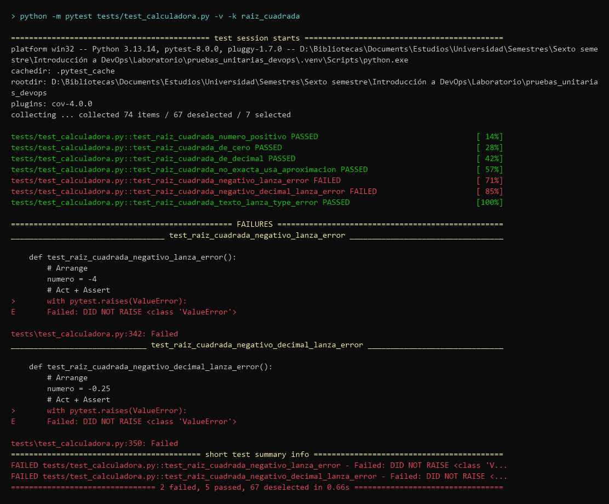
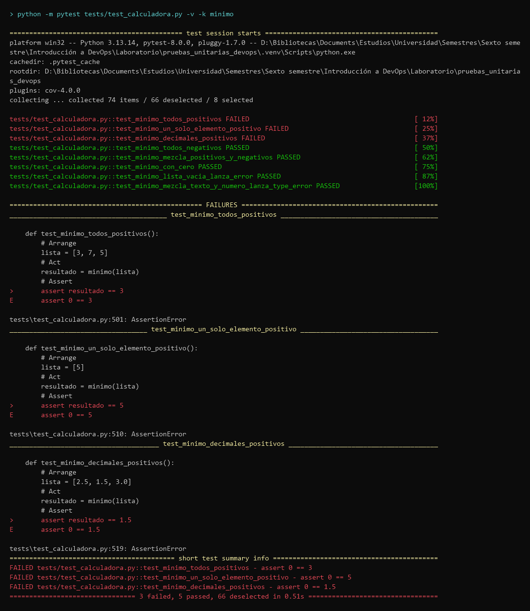
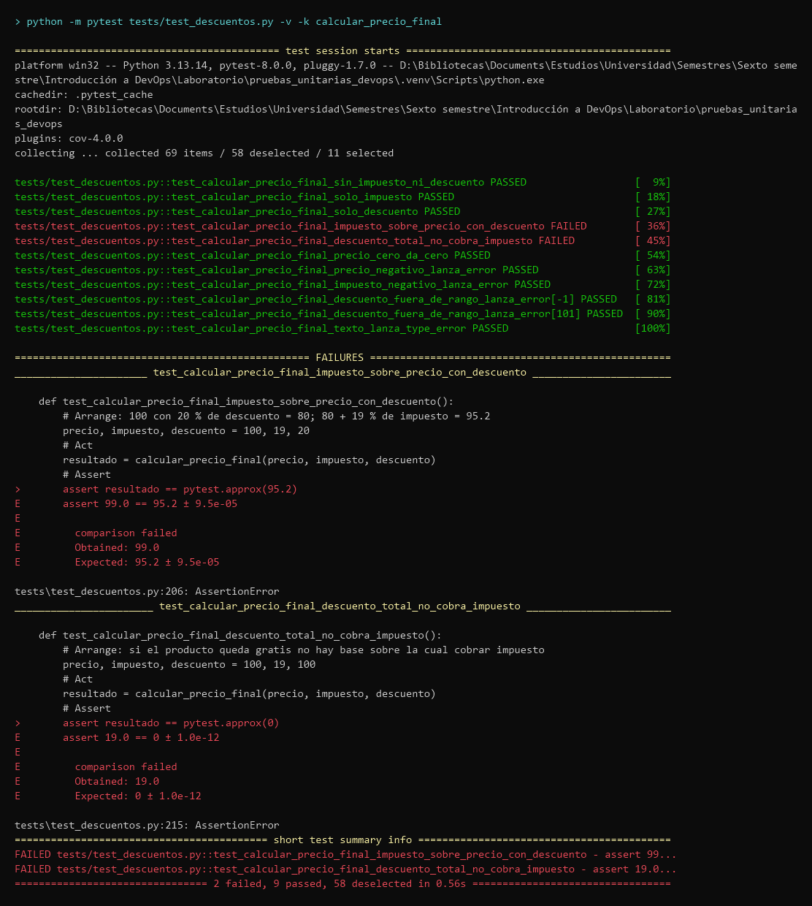
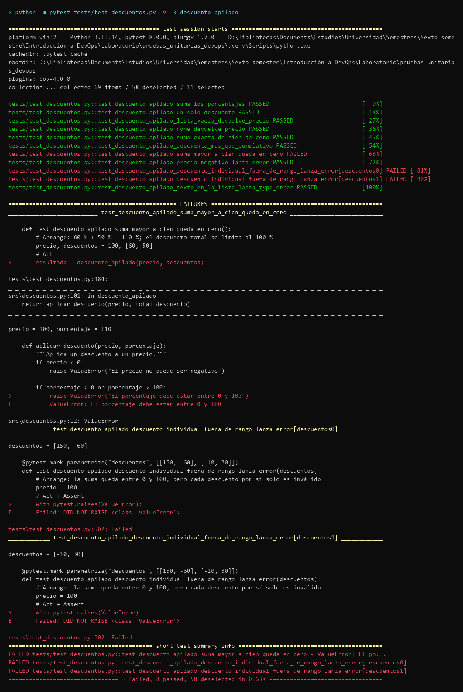
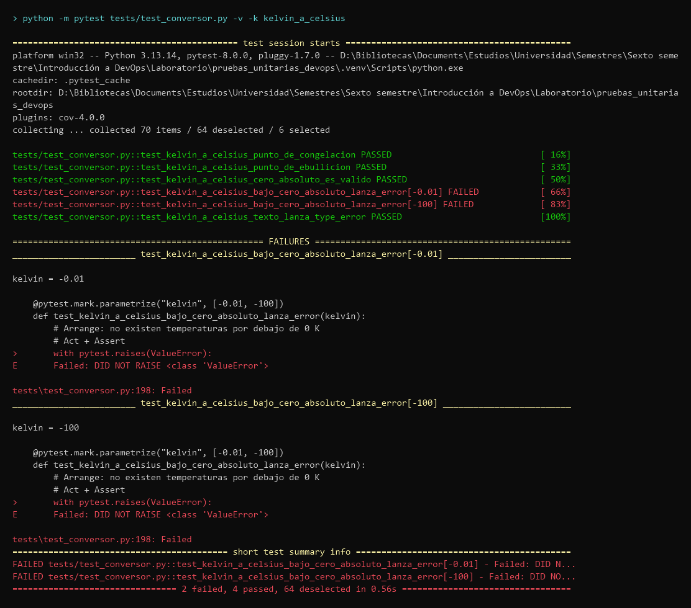
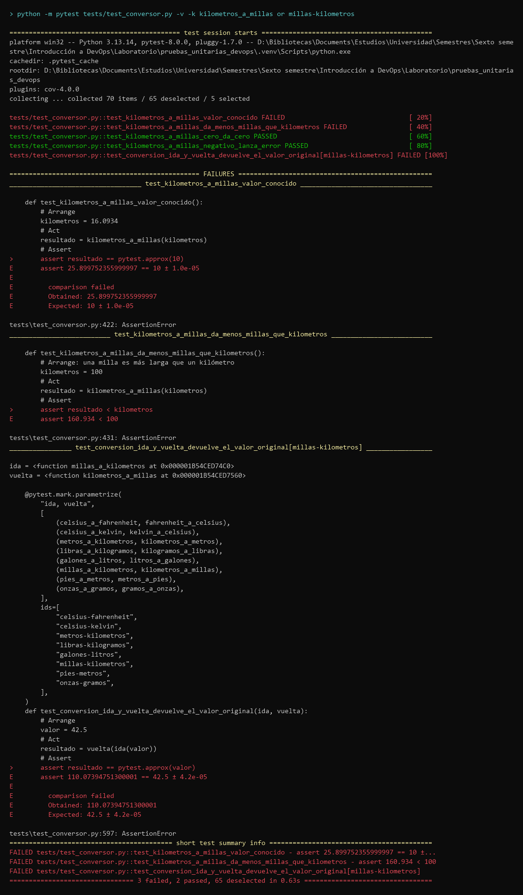
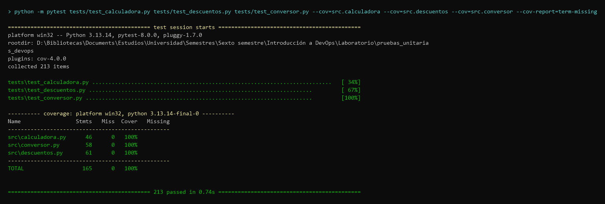
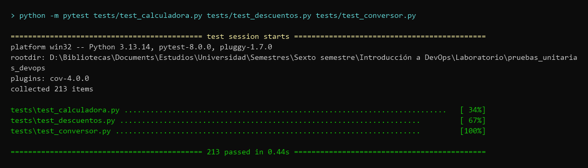

# Informe — Taller de Análisis y Mejora de Pruebas Unitarias

## 1. Datos

- **Nombre:** Andrés Hernández · andrhernandez@unal.edu.co
- **Grupo:** 1
- **Fecha:** 17 de octubre de 2026
- **Curso:** Introducción a DevOps — Universidad Nacional de Colombia, Sede Manizales
- **Profesor:** César Augusto Palacios Alarcón
- **Repositorio:** https://github.com/Hernandez2404/pruebas_unitarias_devops
- **Módulos trabajados:** `calculadora.py` y `descuentos.py` (obligatorios) y `conversor.py` (libre)

| Módulo | Pruebas | Bugs corregidos | Cobertura |
|---|---|---|---|
| `calculadora.py` | 74 | 2 (+1 hallazgo adicional) | 100 % |
| `descuentos.py` | 69 | 2 | 100 % |
| `conversor.py` | 70 | 2 | 100 % |
| **Total** | **213** | **6 (+1)** | **100 %** |

Para reproducir los resultados:

```bash
python -m venv .venv
source .venv/bin/activate          # Windows: .venv\Scripts\activate
pip install -r requirements.txt
pytest tests/test_calculadora.py tests/test_descuentos.py tests/test_conversor.py -v
```

## 2. Análisis por módulo

**Criterio general.** Todas las pruebas siguen la estructura AAA (Arrange, Act, Assert) y el patrón de nombre `test_<funcion>_<escenario>_<resultado>`, de modo que una prueba en rojo explica por sí sola qué se rompió. Para cada función se cubrieron tres familias de casos: **normales**, **límite** e **inválidos**. Se usó `pytest.approx` para comparar flotantes, `pytest.raises(..., match=...)` para verificar tanto el tipo de excepción como su mensaje, y `parametrize` cuando una misma regla debía comprobarse con varias entradas. El valor esperado de cada prueba se obtuvo del dominio (docstring, matemáticas, física o reglas de negocio) y no de lo que el código devolvía en ese momento: eso es lo que convierte una prueba en un detector de bugs.

### calculadora.py

**Qué hace:** 11 funciones: aritmética básica, potencia, raíz cuadrada, estadísticas sobre listas (promedio, máximo, mínimo) y área y perímetro de un rectángulo.

**Casos que decidí probar y por qué:**
- **Listas:** vacía (debe lanzar `ValueError`), un solo elemento, repetidos, todos negativos y **todos positivos**. Este último fue clave: un acumulador que arranca en un valor fijo (como 0) solo falla cuando ningún elemento queda por debajo de ese valor. Con una lista mezclada el bug pasa inadvertido.
- **Fuera del dominio matemático:** raíz de un negativo, 0 elevado a un exponente negativo, división entre `0` y entre `0.0`. Una entrada inválida debe producir un error controlado (`ValueError`), no un resultado absurdo (un número complejo) ni una excepción distinta según la función.
- **Decimales** (`0.1 + 0.2`) con `pytest.approx`, porque la aritmética de punto flotante no es exacta.
- **Tipos inválidos** (texto, `None`) → `TypeError`, para documentar que el módulo no acepta en silencio datos del tipo equivocado.

### descuentos.py

**Qué hace:** aplica y calcula descuentos porcentuales, calcula el precio final con impuesto, aplica descuentos por volumen según tramos y combina varios descuentos de forma acumulativa o apilada.

**Casos que decidí probar y por qué:**
- **Bordes exactos del rango:** 0 % y 100 % (válidos) frente a −0.01 y 100.01 (inválidos). Los errores de `<` contra `<=` aparecen justo en los bordes.
- **Tramos de volumen:** una prueba con `parametrize` que usa 9/10, 19/20, 49/50 y 99/100 unidades. Cada par verifica el último valor de un tramo y el primero del siguiente.
- **Impuesto y descuento combinados:** las pruebas de "solo impuesto" y "solo descuento" pasan incluso con el bug, porque cuando uno de los dos es cero el orden de aplicación no importa. Por eso se añadió el caso combinado y el de descuento del 100 % (un producto gratis no debería pagar impuesto).
- **Propiedades entre funciones:** monto descontado + precio con descuento = precio original. En el descuento acumulativo el orden de los descuentos no cambia el resultado, y el apilado siempre descuenta más que el acumulativo. Así se valida la coherencia del módulo sin depender de un único ejemplo.
- **Descuentos inválidos que se compensan** en una lista (`[150, -60]`): la suma parece válida, pero cada valor por separado no lo es.

### conversor.py

**Qué hace:** 16 conversiones de unidades de temperatura, distancia, peso y volumen.

**Casos que decidí probar y por qué:**
- **Valores de referencia física:** 0/100 °C, 32/212 °F, −40 (igual en ambas escalas) y el cero absoluto (−273.15 °C = 0 K = −459.67 °F). Usar valores externos conocidos evita deducir el resultado esperado a partir del propio código.
- **Límite físico:** 0 K es válido; −0.01 K no existe y debe rechazarse.
- **Magnitudes negativas** (distancia, peso y volumen) → `ValueError` con su mensaje.
- **Propiedad de ida y vuelta:** una sola prueba con `parametrize` sobre los 8 pares de funciones convierte 42.5 y lo devuelve a la unidad original. Detecta una fórmula invertida sin necesidad de conocer el factor de conversión.
- **Verificación de cordura:** como una milla es más larga que un kilómetro, el número de millas debe ser menor que el de kilómetros.

## 3. Tabla de bugs

Según el README, los tres módulos trabajados tienen 6 bugs ocultos. Se encontraron y corrigieron los 6, cada uno con su propio commit `fix:`.

| # | Módulo / función | Entrada que lo revela | Resultado erróneo | Resultado esperado | Corrección aplicada | Commit |
|---|---|---|---|---|---|---|
| 1 | `calculadora.raiz_cuadrada` | `-4` y `-0.25` | Número complejo `(1.22e-16+2j)` | `ValueError` | Validar `numero < 0` y lanzar `ValueError` | `e6903ac` |
| 2 | `calculadora.minimo` | `[3, 7, 5]` | `0` | `3` | Iniciar el acumulador en `lista[0]` en vez de `0` | `88398b2` |
| 3 | `descuentos.calcular_precio_final` | `(100, 19, 20)` | `99.0` | `95.2` | Calcular el impuesto sobre `precio_con_descuento`, no sobre `precio` | `f49acf8` |
| 4 | `descuentos.descuento_apilado` | `[60, 50]` y `[150, -60]` | `ValueError` con mensaje confuso / `10.0` | `0` / `ValueError` | Validar cada descuento entre 0 y 100 y limitar la suma con `min(..., 100)` | `6c99392` |
| 5 | `conversor.kelvin_a_celsius` | `-100` | `-373.15` | `ValueError` | Validar `kelvin < 0` y lanzar `ValueError` | `3443ae5` |
| 6 | `conversor.kilometros_a_millas` | `16.0934` | `25.8998` | `10` | Dividir entre 1.60934 en lugar de multiplicar | `1430bbf` |
| + | `calculadora.potencia` (hallazgo adicional) | `(0, -1)` | `ZeroDivisionError` | `ValueError` | Validar `base == 0 and exponente < 0`, igual que hace `dividir` | `fc9559f` |

**Decisiones de diseño.** Dos correcciones exigieron definir un comportamiento que el código no especificaba:
- **`potencia(0, -1)`:** no figura entre los bugs del README. Se registró como hallazgo porque era inconsistente con `dividir`, que ante una división por cero lanza `ValueError`.
- **`descuento_apilado`:** cuando la suma supera el 100 % se optó por limitar el descuento total al 100 % (precio 0), porque un precio no puede ser negativo. Además, cada descuento se valida por separado, igual que hace `descuento_cumulativo`.

**Evidencia (antes de corregir):**








## 4. Cobertura

```bash
pytest tests/test_calculadora.py tests/test_descuentos.py tests/test_conversor.py --cov=src.calculadora --cov=src.descuentos --cov=src.conversor --cov-report=term-missing
```

```
---------- coverage: platform win32, python 3.13.14-final-0 ----------
Name                 Stmts   Miss  Cover   Missing
--------------------------------------------------
src\calculadora.py      46      0   100%
src\conversor.py        58      0   100%
src\descuentos.py       61      0   100%
--------------------------------------------------
TOTAL                  165      0   100%

213 passed
```



**Lectura de resultados.** Los tres módulos alcanzan el 100 % de cobertura de líneas (165 sentencias, ninguna sin ejecutar), por encima de la meta del 85 %. La cobertura se midió solo sobre los módulos trabajados y no con `--cov=src`, porque los módulos sin pruebas habrían distorsionado el total. El 100 % no fue un objetivo en sí mismo, sino la consecuencia de probar la rama de error de cada función (cada `raise`); la columna *Missing* sirvió para confirmar que ninguna validación quedó sin ejecutar. Aun así, este número no garantiza que el código sea correcto, como se argumenta en la reflexión.

**Ejecución final en verde:**



## 5. Reflexión final

**¿Qué NO mide la cobertura?** La cobertura dice qué líneas se ejecutaron, no si las aserciones comprueban el resultado correcto ni si se eligieron las entradas que importan. En este taller hubo ejemplos claros:
- `minimo([4, -2, 9])` ejecuta todas las líneas de `minimo` y devuelve `-2` correctamente aun con el bug. Solo una lista de positivos lo delata.
- `kilometros_a_millas(0)` ejecuta la fórmula invertida y devuelve `0`, correcto por coincidencia.
- El caso más importante: la cobertura **no puede detectar validaciones ausentes**. En `raiz_cuadrada` y en `kelvin_a_celsius` el bug era justamente una línea que no existía, y no hay ninguna línea sin cubrir que lo señale. La cobertura mide el código que está escrito, no el que debería estar.

**¿Qué aprendí?**
- **Una prueba es una especificación.** Escribir el valor esperado a partir del dominio, y no de la salida actual, es lo que convierte una prueba en un detector. Cuando el código era ambiguo (`potencia`, `descuento_apilado`) hubo que decidir el comportamiento correcto, y la prueba deja esa decisión documentada.
- **El ciclo rojo → evidencia → corrección → commit da trazabilidad.** Cada bug tiene una prueba que lo revela, una captura previa y un commit de corrección propio. El historial permite saber qué cambio arregló qué, como en el pilar de trazabilidad visto en clase.
- **Las pruebas son una red de seguridad.** Después de cada corrección se ejecutó la suite completa, de modo que una corrección que rompiera otra función se habría detectado de inmediato. Es la base de un pipeline de CI: el mismo comando puede ejecutarse en GitHub Actions en cada push.
- **Reproducibilidad.** Un entorno virtual aislado (`.venv`) con versiones fijadas en `requirements.txt` hace que el resultado sea el mismo en otra máquina.

## 6. Bitácora de uso de IA

- **Herramienta:** Claude Code (CLI de Anthropic), ejecutado sobre el repositorio local en Windows 11 con PowerShell.
- **Modelo:** Claude Opus 5.5 (`claude-opus-5-5`).
- **Fechas:** 16 y 17 de octubre de 2026.
- **Rol de la IA:** asistente de programación con acceso al repositorio local. Leía el código, ejecutaba pytest, escribía pruebas, aplicaba las correcciones autorizadas y generaba las evidencias.

### Resumen de prompts

| #   | Prompt (resumen)                                                                                                                                                 | Resultado                                                                                                                             |
| --- | ---------------------------------------------------------------------------------------------------------------------------------------------------------------- | ------------------------------------------------------------------------------------------------------------------------------------- |
| 1   | "Analiza el proyecto, no modifiques el código sin que yo te lo diga; crea más pruebas para calculadora con casos no válidos; agrega el taller al `.gitignore`."  | Análisis de los módulos y de la guía. `test_calculadora.py` pasó de 13 a 74 pruebas y aparecieron los 2 bugs y el caso de `potencia`. |
| 2   | "Haz el environment aquí y ejecuta la parte de la guía sobre el entorno."                                                                                        | Se creó `.venv` y se instaló `requirements.txt` (pytest 8.0.0, pytest-cov 4.0.0); primera medición de cobertura.                      |
| 3   | Preguntas conceptuales: el archivo `.coverage`, cómo ejecutar las pruebas por archivo, cómo activar el `.venv`, qué es el reporte de cobertura y qué se entrega. | Explicaciones, sin cambios en el código.                                                                                              |
| 4   | "¿Puedes tomar las fotos y guardarlas?"                                                                                                                          | Imágenes de evidencia generadas a partir de la salida real de pytest (01 y 02).                                                       |
| 5   | "Soluciona los bugs; con `potencia` pon el que más recomiendes."                                                                                                 | 3 commits `fix:` en `calculadora.py`.                                                                                                 |
| 6   | "Crea las pruebas de descuentos con las mismas indicaciones" → "crea las imágenes" → "corrige los bugs".                                                         | 69 pruebas, evidencias 03 y 04, 2 commits `fix:`.                                                                                     |
| 7   | El mismo flujo para `conversor.py`.                                                                                                                              | 70 pruebas, evidencias 05 y 06, 2 commits `fix:`.                                                                                     |
| 8   | "Genera las capturas finales de los 3 módulos y el informe con bitácora de IA."                                                                                  | Evidencias 09 y 10, y este informe.                                                                                                   |

Fuera del alcance de este informe, en la misma sesión también se generaron pruebas para `csv_parser.py` (con mocking) y para `manipulador_texto.py`.

### Intervención humana

- **Restricciones y autorización:** fijé la regla de no modificar `src/` sin autorización explícita. Cada corrección se aplicó solo después de mi aprobación.
- **Alcance:** elegí los módulos del informe y aprobé `conversor.py` como tercer módulo, a propuesta de la IA.
- **Revisión y control de versiones:** revisé los resultados de cada etapa e hice los commits y el push de las pruebas y las evidencias (por ejemplo, "Pruebas mejoradas calculadora", "pruebas descuentos", "pruebas conversion").
- **Decisiones de diseño:** acepté la recomendación de la IA para `potencia(0, -1)` (lanzar `ValueError`) y el criterio de `descuento_apilado` (limitar al 100 % y validar cada descuento).
- **Comprensión:** hice preguntas conceptuales (cobertura, `.coverage`, entorno virtual) antes de avanzar a cada fase.
- **Redacción del informe:** la IA generó el borrador a partir del trabajo de la sesión; la revisión y el ajuste final fueron míos.

### Transparencia sobre las evidencias

Las imágenes de la carpeta `evidencias/` no son capturas de pantalla manuales. La IA ejecutó pytest en el `.venv` local y convirtió la salida real de la terminal en imágenes PNG, así que el texto de cada imagen es exactamente lo que produjo pytest. Las capturas en rojo se generaron antes de cada corrección, lo que puede verificarse en el historial: el commit de evidencias de cada módulo es anterior a sus commits `fix:`.

### Resultado de aprendizaje

- La estructura AAA y los nombres descriptivos hacen que una prueba fallida sea autoexplicativa.
- El valor esperado debe salir del dominio, nunca del código bajo prueba.
- Los bugs se esconden en los bordes: 0, 100, −0.01, el primer y el último elemento y el cambio entre tramos.
- `pytest.approx` sirve para flotantes,`pytest.raises(..., match=...)` verifica el tipo y el mensaje de la excepción, y `parametrize` permite comprobar una misma regla con muchas entradas.
- Las pruebas de propiedades (ida y vuelta, independencia del orden) detectan errores sin necesidad de conocer el valor exacto.
- Una cobertura del 100 % no significa que el código sea correcto, y en particular no detecta validaciones ausentes.
- El ciclo rojo → evidencia → corrección → commit aporta trazabilidad y es la base de la integración continua.
- La IA acelera la escritura de pruebas y el diagnóstico, pero el comportamiento esperado cuando el código es ambiguo requiere criterio humano, y cada sugerencia se verificó ejecutando las pruebas.
